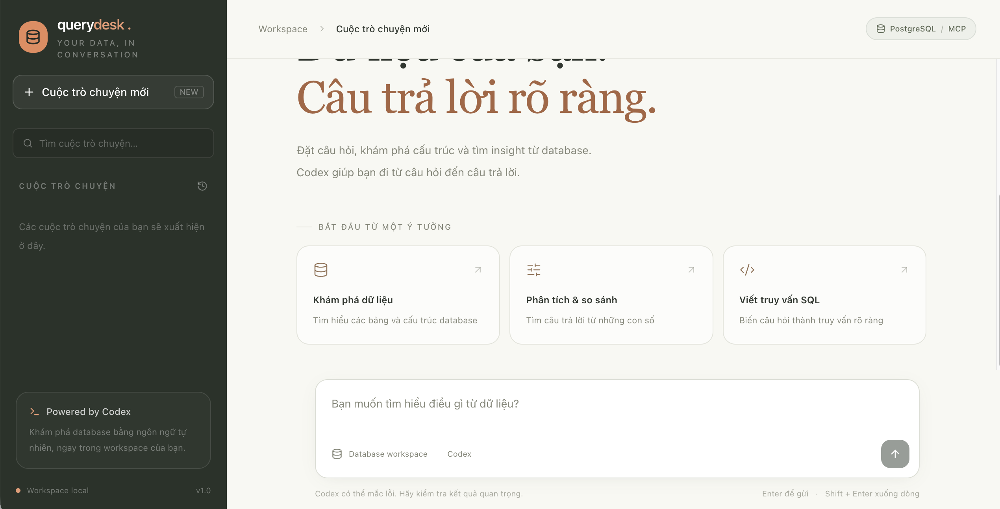

# Querydesk frontend

React + TypeScript + Vite, Tailwind CSS và shadcn/ui. Dependencies quản lý bằng Bun.

## Kiến trúc

Frontend là SPA chạy trên trình duyệt; nó không truy cập Codex hoặc PostgreSQL trực tiếp.
Mọi yêu cầu hội thoại đi qua REST và SSE của FastAPI:

```text
Browser
  └─ React UI (App.tsx)
      ├─ useChat: trạng thái hội thoại, gửi prompt, tải lịch sử, steer/interrupt
      ├─ lib/api: REST /v1 và EventSource /v1/events
      ├─ DatabaseActivity: gom sự kiện MCP theo turnId
      └─ Vite dev proxy ──> FastAPI :8000 ──> Codex ──> MCP PostgreSQL
```

Trong development, Vite phục vụ trang ở `:5173` và proxy `/v1`, `/health` tới
`http://127.0.0.1:8000` (xem `vite.config.ts`). Khi build, `VITE_API_URL` có thể
trỏ API sang domain khác; cùng giá trị này được dùng cho REST và SSE.

### Trách nhiệm các phần

- `src/main.tsx`: mount React root và stylesheet toàn cục.
- `src/App.tsx`: bố cục sidebar/chat, form gửi câu hỏi, render Markdown và thao tác người dùng.
- `src/hooks/use-chat.ts`: state machine phía client cho thread, messages, turn đang chạy,
  SSE, lỗi, steer, interrupt và phân trang danh sách.
- `src/lib/api.ts`: kiểu dữ liệu, URL gốc và hàm gọi API; đây là lớp duy nhất chuyển đổi
  request/response HTTP cho các chức năng chat.
- `src/components/database-activity.tsx`: trình bày `search_objects`/`execute_sql` và kết quả
  được gắn theo `turnId`, tránh nhầm tool của câu hỏi trước với câu hỏi sau.
- `src/components/ui/`: các primitive giao diện dùng chung; `src/index.css` khai báo theme,
  layout và responsive styles.

### Luồng dữ liệu chat

1. `useChat` tạo thread qua `POST /v1/threads`, sau đó gửi prompt qua
   `POST /v1/threads/{id}/turns`.
2. Backend trả `turnId` và `eventCursor`; client mở `EventSource` tới
   `/v1/events?threadId=...&turnId=...&after=...` để nhận event Codex theo thời gian thực.
3. Hook ghép delta thành tin nhắn, giữ trạng thái tool theo event và đóng stream khi turn kết thúc.
   `turnId` được giữ trên message/tool để lịch sử và hoạt động database luôn nằm trong đúng lượt.
4. Khi chọn thread, client tải lịch sử từ `GET /v1/threads/{id}?includeTurns=true`; steer và
   interrupt dùng endpoint turn tương ứng.

Backend chịu trách nhiệm xác thực/điều phối Codex, buffer SSE và lưu registry thread; MCP chịu
trách nhiệm đọc metadata và thực thi SQL. Frontend chỉ hiển thị kết quả và không lưu dữ liệu chat
bền vững trong browser.

## Ảnh giao diện

Ảnh dưới đây là trang bắt đầu chat của Querydesk, chụp từ frontend đang chạy ở chế độ development.
Danh sách hội thoại và câu trả lời chỉ xuất hiện khi backend cùng Codex được cấu hình và hoạt động.



## Chạy frontend riêng

```bash
cd front-end
bun install --frozen-lockfile
bun run dev
```

Mở http://localhost:5173. Backend chạy ở port 8000; Vite proxy `/v1` và `/health`
tới backend. FastAPI chỉ phục vụ API, không phục vụ giao diện.

## Build và deploy riêng

```bash
bun run build
bun run preview
```

Build nằm trong `front-end/dist`; preview ở http://localhost:4173.
Nếu deploy khác domain, đặt URL backend trước khi build:

```bash
VITE_API_URL=https://api.example.com bun run build
```

Host nội dung `dist` bằng static hosting hoặc web server. Backend cần đặt
`BACKEND_CORS_ORIGINS=["https://app.example.com"]` để cho phép domain frontend.
`VITE_API_URL` áp dụng cho cả fetch API và EventSource SSE.

## Chức năng

- Tạo và tìm cuộc trò chuyện, tải thêm danh sách phân trang.
- Xóa hội thoại bằng nút thùng rác trong sidebar, có xác nhận xóa vĩnh viễn.
- Đọc lịch sử từ Codex, gửi turn mới vào cùng thread.
- SSE với `eventCursor`, hiển thị text và trạng thái MCP tools.
- Khối **Hoạt động database** nằm dưới các tin nhắn của từng lượt hỏi; số lần
  gọi, tham số, kết quả, lỗi và thời gian chạy được hiển thị riêng cho lượt đó.
- Tin nhắn và tool được gắn `turnId` ở cả stream và lịch sử; gửi câu hỏi mới
  hoặc tải lại chat không đẩy hoạt động của lượt cũ xuống cuối cuộc trò chuyện.
- Lượt không gọi tool không có khối hoạt động. Steer thuộc turn đang chạy.
- Bổ sung hướng dẫn (steer) và dừng phản hồi (interrupt).
- Hiển thị Markdown, bảng và SQL; sao chép câu trả lời.
- Menu responsive cho màn hình hẹp.

## Kiểm tra

```bash
bun run test
bun run lint
bun run build
```

Unit tests dùng API giả lập, bao gồm kiểm tra hoạt động database giữ đúng
lượt khi có câu hỏi mới và số lần gọi được tách riêng cho mỗi lượt.
Build kiểm tra TypeScript; lint dùng oxlint. Các kiểm tra này chưa xác nhận
chat với Codex/database thật.

Để kiểm tra thủ công, chạy MCP và backend rồi gửi hai câu hỏi liên tiếp có
truy vấn database. Mở khối hoạt động của từng lượt, kiểm tra số lần gọi và
kết quả; tải lại trang và chọn lại hội thoại để xác nhận vị trí vẫn đúng.
Thử thêm một lượt không gọi tool để kiểm tra không xuất hiện khối hoạt động
của lượt trước ở cuối chat.

## Format code

```bash
bun run format          # Format bằng Prettier
bun run format:check    # Kiểm tra format, không sửa file
```

Prettier format TypeScript, TSX, CSS, JSON và Markdown; oxlint kiểm tra lỗi code.
